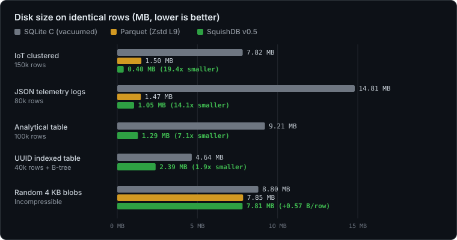

# SquishDB

[](https://github.com/F1nnD3v/squishdb/actions/workflows/ci.yml)
[](LICENSE)

SquishDB is a single-file embedded SQL database written in Rust. It stores rows in 4,096-row columnar pages and picks the smallest lossless codec for each column on each page. On our benchmark suite, database files come out 6x to 19.4x smaller than vacuumed SQLite files, and smaller than Parquet at Zstd level 9, with bit-exact round-trips for integers, IEEE-754 floats, text, and blobs.

This release is `v0.5.0-alpha.1` (`SQSHDB05`). Existing `SQSHDB04` databases migrate forward automatically on open. Keep separate backups if you put production data in an alpha release.

For full CLI flags, Rust API examples, SQL syntax, and tuning notes, read [docs/GUIDE.md](docs/GUIDE.md). For Python, TypeScript/JavaScript, Java/Kotlin, C#/.NET, Go, C, and C++ bindings, read [docs/BINDINGS.md](docs/BINDINGS.md).

## Quick start

Install the CLI with Rust 1.75 or newer:

```bash
cargo install --git https://github.com/F1nnD3v/squishdb
```

Or build from source:

```bash
git clone https://github.com/F1nnD3v/squishdb.git
cd squishdb
cargo build --release
```

Run SQL from the command line:

```bash
squishdb sensors.sqdb -c "
  CREATE TABLE devices (id INTEGER PRIMARY KEY, name TEXT NOT NULL UNIQUE);
  CREATE TABLE readings (
    id INTEGER PRIMARY KEY,
    device_id INTEGER NOT NULL REFERENCES devices(id) ON DELETE CASCADE,
    ts INTEGER NOT NULL,
    temp REAL CHECK (temp > -273.15)
  ) CLUSTER BY (device_id, ts);
  CREATE INDEX idx_dev_ts ON readings (device_id, ts);
  INSERT INTO devices VALUES (1, 'dev-01');
  INSERT INTO readings VALUES (1, 1, 1700000000, 21.5), (2, 1, 1700000060, 21.7);
  SELECT device_id, COUNT(*), AVG(temp) FROM readings GROUP BY device_id;
"

# Migrate an existing SQLite 3 database directly to .sqdb (pure Rust, no libsqlite3)
squishdb migrate legacy.sqlite migrated.sqdb --cluster readings:device_id,ts

# Open the interactive REPL
squishdb sensors.sqdb

# Print storage, compression ratio, index, and cache stats
squishdb stats sensors.sqdb
```

### Rust library

Add the crate to `Cargo.toml`:

```toml
[dependencies]
squishdb = { git = "https://github.com/F1nnD3v/squishdb" }
```

Single-handle usage:

```rust
use squishdb::{Database, QueryResult};

fn main() -> squishdb::types::Result<()> {
    let mut db = Database::open("app.sqdb")?;
    db.execute(
        "CREATE TABLE IF NOT EXISTS events (
            id INTEGER PRIMARY KEY,
            kind TEXT NOT NULL,
            amount REAL CHECK (amount >= 0.0)
         ) CLUSTER BY (kind);
         INSERT INTO events VALUES (1, 'signup', 0.0), (2, 'purchase', 49.99);",
    )?;

    for res in db.execute("SELECT kind, COUNT(*), SUM(amount) FROM events GROUP BY kind;")? {
        if let QueryResult::Rows { columns, rows } = res {
            println!("{:?} -> {:?}", columns, rows);
        }
    }

    db.backup_to("app-backup.sqdb")?;
    Ok(())
}
```

Multi-threaded multi-writer MVCC usage with `SharedDatabase`:

```rust
use std::thread;
use squishdb::SharedDatabase;

fn main() -> squishdb::types::Result<()> {
    let shared = SharedDatabase::open("concurrent.sqdb")?;
    shared.connect().execute(
        "CREATE TABLE accounts (id INTEGER PRIMARY KEY, balance INTEGER CHECK (balance >= 0));
         INSERT INTO accounts VALUES (1, 100), (2, 200);",
    )?;

    let s1 = shared.clone();
    let s2 = shared.clone();
    let t1 = thread::spawn(move || -> squishdb::types::Result<()> {
        let mut c = s1.connect();
        c.execute("BEGIN; UPDATE accounts SET balance = balance + 25 WHERE id = 1; COMMIT;")?;
        Ok(())
    });
    let t2 = thread::spawn(move || -> squishdb::types::Result<()> {
        let mut c = s2.connect();
        c.execute("BEGIN; UPDATE accounts SET balance = balance + 50 WHERE id = 2; COMMIT;")?;
        Ok(())
    });
    t1.join().unwrap()?;
    t2.join().unwrap()?;
    Ok(())
}
```

### Other languages (Python, TypeScript/JS, Java/Kotlin, C#, Go, C/C++)

`cargo build --release` builds both the CLI binary and the native C ABI library (`squishdb.dll`, `libsquishdb.so`, `libsquishdb.dylib`) with parameterized SQL (`?` and `$1`) and bulk PAX ingestion. Language bindings live under `include/` and `bindings/`:

- **Python** (`bindings/python/`). Zero-dependency `ctypes` package with PEP 249 DB-API 2.0 (`connect`, `cursor`, `execute`, `bulk_insert`).
- **TypeScript / JavaScript** (`bindings/typescript/`). Zero-dependency Node.js, Bun, and Deno client with `.d.ts` types over persistent `squishdb rpc`.
- **Java & Kotlin** (`bindings/java/`). Zero-dependency Java 22+ Foreign Function & Memory (`java.lang.foreign`) binding.
- **C# / .NET** (`bindings/csharp/`). Zero-dependency P/Invoke library targeting `.NET 8+`.
- **Go** (`bindings/go/`). `cgo` package linking directly against `include/squishdb.h`.
- **C & C++17** (`include/squishdb.h`, `include/squishdb.hpp`). C99 API and header-only RAII C++17 wrapper.
- **Other languages** (PHP, Ruby, Swift, Dart, Zig). Call `libsquishdb` via FFI or connect to `squishdb rpc <file.sqdb>` over newline-delimited JSON-RPC stdio.

See [docs/BINDINGS.md](docs/BINDINGS.md) for install commands and examples in each language.

## How it works

A database lives in one `.sqdb` file with double-buffered A/B CRC32 superblocks, a CRC32-framed `.sqdb-wal` write-ahead log, and OS file locking (`LockFileEx` on Windows, `flock` on Unix) in [src/lock.rs](src/lock.rs).

**PAX-v4 columnar pages and forward format migration.** Each 4,096-row page stores a CRC32-verified chunk offset table followed by independently compressed column chunks in [src/pax.rs](src/pax.rs) and [src/storage.rs](src/storage.rs). Queries only read, verify, and decompress the columns they touch. Format `SQSHDB05` reads `SQSHDB04` files directly and upgrades them atomically through the inactive A/B superblock slot.

**Per-column lossless codecs.** The encoder in [src/encoding.rs](src/encoding.rs) tries codecs per column and keeps the smallest output. Integers use Constant, FOR + Bitpack, Delta + ZigZag + Bitpack, Delta + Varint, RLE, Dictionary + Bitpack, or Raw, and `INTEGER PRIMARY KEY` aliases `rowid` for zero duplicate bytes. Floats use Constant, ScaledDecimal verified bit-for-bit via `.to_bits()`, 8-lane ByteShuffle, or Raw. Text and blobs use Constant, lexicographically sorted front-coded dictionaries, or split-length Raw.

**Parallel query execution and compression.** [src/parallel.rs](src/parallel.rs) runs a reusable worker pool for multi-page `GROUP BY` partial hash aggregation, parallel sequential scans, parallel PAX page compression during `bulk_insert`, `checkpoint`, and `VACUUM`, and parallel index builds. Configure worker count with `DbOptions.parallel_workers` or `SET max_parallel_workers = N;`.

**Multi-writer MVCC and nested savepoints.** [src/mvcc.rs](src/mvcc.rs) provides `SharedDatabase` and `MvccConnection` with Snapshot Isolation. Readers never block writers and writers never block readers. Disjoint row or table writes commit concurrently, while overlapping writes enforce First-Committer-Wins conflict detection. Both `Database` and `MvccConnection` support nested `SAVEPOINT`, `RELEASE SAVEPOINT`, and `ROLLBACK TO SAVEPOINT`.

**Composite and range B-tree secondary indexes.** [src/index.rs](src/index.rs) writes 4,096-entry front-coded compressed B-tree leaf blocks (and optional `USING HASH` blocks) with a sparse directory in the catalog, an LRU block cache in [src/cache.rs](src/cache.rs), and automatic 6-bit-per-key per-page Bloom filters. B-tree indexes handle equality, `<`, `<=`, `>`, `>=`, `BETWEEN`, `UNIQUE`, `ASC`/`DESC`, and leftmost composite prefixes.

**Direct SQLite 3 migration.** [src/sqlite_import.rs](src/sqlite_import.rs) parses SQLite 3 B-tree pages, overflow chains, record serial types, and `-wal` files in pure Rust without linking `libsqlite3`, copying tables, constraints, and indexes straight into compressed PAX pages.

**SQL engine.** [src/sql.rs](src/sql.rs) implements `WITH` CTEs, `FROM` and `IN` subqueries, window functions (`ROW_NUMBER()`, `RANK()`, `SUM`/`AVG`/`COUNT` `OVER`), hash `INNER` and `LEFT JOIN`, `GROUP BY`/`HAVING`, `FOREIGN KEY` (`RESTRICT`, `CASCADE`, `SET NULL`, `SET DEFAULT`), `CHECK`, `UNIQUE`, `DEFAULT`, nested `SAVEPOINT`s, O(1) `ALTER TABLE ADD COLUMN`, `CLUSTER BY`, `VACUUM [SORT BY ...]`, `BACKUP TO`, and `EXPLAIN`.

## Benchmarks

Measured against vacuumed SQLite C and Apache Parquet with Zstd level 9 on the same synthetic relational datasets:




| Benchmark | SQLite C | Parquet (Zstd L9) | SquishDB v0.5 | Comparison |
|---|---:|---:|---:|---:|
| GROUP BY + SUM/AVG/COUNT (100k rows) | 20.46 ms, 9.21 MB | n/a | 1.77 ms, 1.29 MB | 11.56x faster, 7.14x smaller |
| 200 random UUID lookups (40k rows, B-tree) | 14.80 ms, 4.64 MB | n/a | 14.55 ms, 2.39 MB | 1.02x faster, 1.94x smaller |
| UUID B-tree index disk overhead (40k rows) | +1,752 KB | n/a | +888 KB | 1.97x smaller B-tree index |
| Multi-device IoT clustered (150k rows) | 7.82 MB | 1.50 MB | 0.40 MB | 19.45x smaller than SQLite, 3.75x smaller than Parquet |
| JSON telemetry logs (80k rows) | 14.81 MB | 1.47 MB | 1.05 MB | 14.10x smaller than SQLite |
| Random 4 KB blobs (incompressible) | 8.80 MB | 7.85 MB | 7.81 MB | +0.57 B/row overhead |

### Insert throughput

Measured in release mode:

- Single-row auto-commit with `sync_wal = true` (fsync per row): 1,241 rows/sec.
- Single-row auto-commit with `sync_wal = false` (buffered WAL): 158,626 rows/sec.
- Batched WAL transaction at 1,000 rows per `COMMIT` with `sync_wal = true`: 445,323 rows/sec.
- Direct bulk PAX-v4 load plus parallel Brotli checkpoint over 50,000 rows: 2,237,717 rows/sec.

Single-row fsynced writes are bound by disk fsync latency, so wrap bulk writes in `BEGIN` / `COMMIT` or call `insert_batch` or `bulk_insert`.

## Backups

Run an online atomic backup from SQL:

```sql
BACKUP TO 'backup.sqdb';
```

This checkpoints the WAL, writes a temporary copy, calls `sync_all`, and atomically replaces the target file. You can also run `CHECKPOINT;`, close the writer, and copy the `.sqdb` file directly.

## Remaining work before 1.0

- Cost-based join reordering and multi-column `GROUP BY` vectorization.
- `ALTER TABLE DROP COLUMN` and `RENAME COLUMN`.
- `WITHOUT ROWID` table support in `squishdb migrate`.
- Cross-process multi-writer MVCC (today multi-writer MVCC operates across threads in one process via `SharedDatabase`, while cross-process locks use shared readers or one exclusive writer).

## Running tests and benchmarks

```bash
cargo test --release

# Head-to-head SQLite and Parquet benchmarks (Python 3; optional pyarrow for Parquet)
python3 benchmarks/compare_sqlite.py balanced
python3 benchmarks/compare_industry.py
python3 benchmarks/bench_v2.py

# Regenerate the README SVG charts from the benchmark JSON output
python3 benchmarks/update_charts.py --measure-throughput
```

## License

MIT. See [LICENSE](LICENSE).
