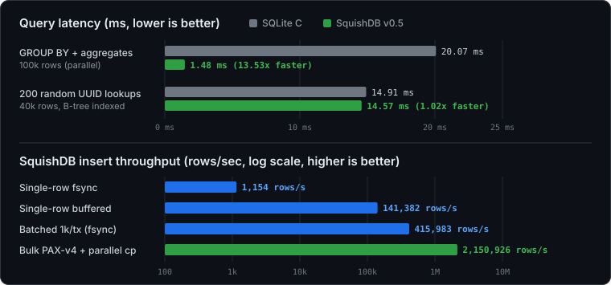

# SquishDB

[](https://github.com/F1nnD3v/squishdb/actions/workflows/ci.yml)
[](LICENSE)

SquishDB is a single-file embedded SQL database written in Rust. It stores rows in 4,096-row columnar pages and picks the smallest lossless codec for each column on each page. On our benchmark suite, database files come out 6x to 19.4x smaller than vacuumed SQLite files, and smaller than Parquet at Zstd level 9, with bit-exact round-trips for integers, IEEE-754 floats, text, and blobs.

This release is `v0.5.0-alpha.1` (`SQSHDB05`). Existing `SQSHDB04` databases migrate forward automatically on open. Keep separate backups if you put production data in an alpha release.

For full CLI flags, Rust API examples, SQL syntax, and tuning notes, read [docs/GUIDE.md](docs/GUIDE.md). For Python, TypeScript/JavaScript, Java/Kotlin, C#/.NET, Go, C, and C++ bindings, read [docs/BINDINGS.md](docs/BINDINGS.md).

## Quick start

Install the CLI with Rust 1.75 or newer:

```bash
cargo install --git https://github.com/F1nnD3v/squishdb
```

Or build from source:

```bash
git clone https://github.com/F1nnD3v/squishdb.git
cd squishdb
cargo build --release
```

Run SQL from the command line:

```bash
squishdb sensors.sqdb -c "
  CREATE TABLE devices (id INTEGER PRIMARY KEY, name TEXT NOT NULL UNIQUE);
  CREATE TABLE readings (
    id INTEGER PRIMARY KEY,
    device_id INTEGER NOT NULL REFERENCES devices(id) ON DELETE CASCADE,
    ts INTEGER NOT NULL,
    temp REAL CHECK (temp > -273.15)
  ) CLUSTER BY (device_id, ts);
  CREATE INDEX idx_dev_ts ON readings (device_id, ts);
  INSERT INTO devices VALUES (1, 'dev-01');
  INSERT INTO readings VALUES (1, 1, 1700000000, 21.5), (2, 1, 1700000060, 21.7);
  SELECT device_id, COUNT(*), AVG(temp) FROM readings GROUP BY device_id;
"

# Migrate an existing SQLite 3 database directly to .sqdb (pure Rust, no libsqlite3)
squishdb migrate legacy.sqlite migrated.sqdb --cluster readings:device_id,ts

# Open the interactive REPL
squishdb sensors.sqdb

# Print storage, compression ratio, index, and cache stats
squishdb stats sensors.sqdb
```

### Rust library

Add the crate to `Cargo.toml`:

```toml
[dependencies]
squishdb = { git = "https://github.com/F1nnD3v/squishdb" }
```

Single-handle usage:

```rust
use squishdb::{Database, QueryResult};

fn main() -> squishdb::types::Result<()> {
    let mut db = Database::open("app.sqdb")?;
    db.execute(
        "CREATE TABLE IF NOT EXISTS events (
            id INTEGER PRIMARY KEY,
            kind TEXT NOT NULL,
            amount REAL CHECK (amount >= 0.0)
         ) CLUSTER BY (kind);
         INSERT INTO events VALUES (1, 'signup', 0.0), (2, 'purchase', 49.99);",
    )?;

    for res in db.execute("SELECT kind, COUNT(*), SUM(amount) FROM events GROUP BY kind;")? {
        if let QueryResult::Rows { columns, rows } = res {
            println!("{:?} -> {:?}", columns, rows);
        }
    }

    db.backup_to("app-backup.sqdb")?;
    Ok(())
}
```

Multi-threaded multi-writer MVCC usage with `SharedDatabase`:

```rust
use std::thread;
use squishdb::SharedDatabase;

fn main() -> squishdb::types::Result<()> {
    let shared = SharedDatabase::open("concurrent.sqdb")?;
    shared.connect().execute(
        "CREATE TABLE accounts (id INTEGER PRIMARY KEY, balance INTEGER CHECK (balance >= 0));
         INSERT INTO accounts VALUES (1, 100), (2, 200);",
    )?;

    let s1 = shared.clone();
    let s2 = shared.clone();
    let t1 = thread::spawn(move || -> squishdb::types::Result<()> {
        let mut c = s1.connect();
        c.execute("BEGIN; UPDATE accounts SET balance = balance + 25 WHERE id = 1; COMMIT;")?;
        Ok(())
    });
    let t2 = thread::spawn(move || -> squishdb::types::Result<()> {
        let mut c = s2.connect();
        c.execute("BEGIN; UPDATE accounts SET balance = balance + 50 WHERE id = 2; COMMIT;")?;
        Ok(())
    });
    t1.join().unwrap()?;
    t2.join().unwrap()?;
    Ok(())
}
```

### Other languages (Python, TypeScript/JS, Java/Kotlin, C#, Go, C/C++)

`cargo build --release` builds both the CLI binary and the native C ABI library (`squishdb.dll`, `libsquishdb.so`, `libsquishdb.dylib`) with parameterized SQL (`?` and `$1`) and bulk PAX ingestion. Language bindings live under `include/` and `bindings/`:

- **Python** (`bindings/python/`). Zero-dependency `ctypes` package with PEP 249 DB-API 2.0 (`connect`, `cursor`, `execute`, `bulk_insert`). CI-verified on Linux, Windows, and macOS.
- **TypeScript / JavaScript** (`bindings/typescript/`). Zero-dependency client with `.d.ts` types over persistent `squishdb rpc`. CI-verified on Node.js 22 (Linux, Windows, macOS). Bun and Deno are experimental.
- **Java** (`bindings/java/`). Zero-dependency Java 22+ Foreign Function & Memory (`java.lang.foreign`) binding. CI-verified on Linux (JDK 25). Windows, macOS, and Kotlin are experimental.
- **C# / .NET** (`bindings/csharp/`). Zero-dependency P/Invoke library targeting `.NET 8+`. CI-verified on Linux (.NET 8). Windows and macOS are experimental.
- **Go** (`bindings/go/`). `cgo` package linking directly against `include/squishdb.h`. CI-verified on Linux (Go 1.23). Windows and macOS are experimental.
- **C & C++17** (`include/squishdb.h`, `include/squishdb.hpp`). C99 API and header-only RAII C++17 wrapper. CI-verified on Linux. Windows and macOS are experimental.
- **Other languages** (PHP, Ruby, Swift, Dart, Zig). Experimental. Call `libsquishdb` via FFI or connect to `squishdb rpc <file.sqdb>` over newline-delimited JSON-RPC stdio.

See [docs/BINDINGS.md](docs/BINDINGS.md) for install commands, full CI status matrix, and examples in each language.

## How SquishDB compares to SQLite and DuckDB

| Dimension | SQLite | DuckDB | SquishDB |
|---|---|---|---|
| Typical binary size | ~1 MB C library | ~40 to 60 MB C++ library | ~1.5 MB pure-Rust binary (no C toolchain) |
| Storage layout | 4 KB row-oriented B-tree pages | Columnar row groups (~122,880 rows) | Hybrid 4,096-row PAX-v4 columnar pages + compressed B-tree secondary indexes |
| Disk footprint on structured data | Baseline (uncompressed pages) | Compact columnar files | 6x to 19.4x smaller than vacuumed SQLite on our benchmark suite |
| Direct SQLite migration | Native | Via SQLite scanner extension | Built-in `squishdb migrate` in pure Rust (no `libsqlite3`) |
| Best fit | Heavy OLTP, random point updates, production reliability | Multi-GB OLAP, Parquet/CSV federation, complex analytical SQL | Embedded single-file archives, telemetry, market data, and local analytics where disk size and binary size matter |

SQLite remains the better choice when your workload is heavy random-update OLTP or when you need decades of battle-tested production durability and SQLite ecosystem extensions. DuckDB remains the better choice for heavy analytical pipelines, full SQL window frames, out-of-core joins, and direct Parquet or object-store querying. SquishDB targets the gap between them for embedded Rust and polyglot applications that want a small pure-Rust binary, direct `.sqlite` migration without `libsqlite3`, much smaller files on disk, and fast vectorized scans over compressed columns.

## Current limitations (Alpha)

- **Write amplification on point updates and deletes.** Persisted PAX-v4 pages store up to 4,096 rows per page. Updating or deleting a single row marks its slot deleted in catalog metadata and appends the replacement row to the hot buffer. Dead slots occupy space until a page becomes empty or you run `VACUUM`. High-churn random-update OLTP workloads are better served by SQLite.
- **Local filesystem locking only.** Cross-process coordination uses `flock` on Unix and `LockFileEx` on Windows in [src/lock.rs](src/lock.rs). These advisory locks require a local disk and are not safe over NFS, SMB, or cloud-synced directories.
- **Crash recovery and fuzzing maturity.** The test suite covers byte-by-byte WAL truncation, every-byte WAL bit-flips, A/B superblock failover on torn checkpoints, atomic `VACUUM` with stale WAL recovery, PAX page CRC32 verification, a 2,000-vector randomized codec test, and a 350-step OLTP oracle test. SquishDB has not yet undergone multi-day coverage-guided fuzzing (AFL/libFuzzer) or kernel power-loss fault injection (`dm-flakey`).
- **SQL dialect scope.** SquishDB implements a practical subset of SQLite-style SQL, not complete SQLite compatibility. Triggers, views, virtual tables, FTS, JSON SQL functions, recursive CTEs, and `PRAGMA` statements are not implemented.
- **Cross-platform binding coverage.** The Rust core, Python binding, and Node.js binding are CI-verified on Linux, Windows, and macOS. C, C++17, Java (JDK 25), C#/.NET 8, and Go bindings are currently CI-verified on Linux only. Bun, Deno, and Kotlin remain experimental.

## How it works

A database lives in one `.sqdb` file with double-buffered A/B CRC32 superblocks, a CRC32-framed `.sqdb-wal` write-ahead log, and OS file locking (`LockFileEx` on Windows, `flock` on Unix) in [src/lock.rs](src/lock.rs).

**PAX-v4 columnar pages and forward format migration.** Each 4,096-row page stores a CRC32-verified chunk offset table followed by independently compressed column chunks in [src/pax.rs](src/pax.rs) and [src/storage.rs](src/storage.rs). Queries only read, verify, and decompress the columns they touch. Format `SQSHDB05` reads `SQSHDB04` files directly and upgrades them atomically through the inactive A/B superblock slot.

**Per-column lossless codecs.** The encoder in [src/encoding.rs](src/encoding.rs) tries codecs per column and keeps the smallest output. Integers use Constant, FOR + Bitpack, Delta + ZigZag + Bitpack, Delta + Varint, RLE, Dictionary + Bitpack, or Raw, and `INTEGER PRIMARY KEY` aliases `rowid` for zero duplicate bytes. Floats use Constant, ScaledDecimal verified bit-for-bit via `.to_bits()`, 8-lane ByteShuffle, or Raw. Text and blobs use Constant, lexicographically sorted front-coded dictionaries, or split-length Raw.

**Parallel query execution and compression.** [src/parallel.rs](src/parallel.rs) runs a reusable worker pool for single-column and multi-column vectorized `GROUP BY` partial hash aggregation, parallel sequential scans, parallel PAX page compression during `bulk_insert`, `checkpoint`, and `VACUUM`, and parallel index builds. Configure worker count with `DbOptions.parallel_workers` or `SET max_parallel_workers = N;`.

**Cross-process multi-writer MVCC and nested savepoints.** [src/mvcc.rs](src/mvcc.rs) provides `SharedDatabase` and `MvccConnection` with Snapshot Isolation across threads and across separate OS processes. Readers never block writers and writers never block readers. Disjoint row or table writes commit concurrently using incremental WAL sync and a CRC32-framed MVCC commit log, while overlapping writes enforce First-Committer-Wins conflict detection. Both `Database` and `MvccConnection` support nested `SAVEPOINT`, `RELEASE SAVEPOINT`, and `ROLLBACK TO SAVEPOINT`.

**Composite and range B-tree secondary indexes.** [src/index.rs](src/index.rs) writes 4,096-entry front-coded compressed B-tree leaf blocks (and optional `USING HASH` blocks) with a sparse directory in the catalog, an LRU block cache in [src/cache.rs](src/cache.rs), and automatic 6-bit-per-key per-page Bloom filters. B-tree indexes handle equality, `<`, `<=`, `>`, `>=`, `BETWEEN`, `UNIQUE`, `ASC`/`DESC`, and leftmost composite prefixes.

**Direct SQLite 3 migration.** [src/sqlite_import.rs](src/sqlite_import.rs) parses SQLite 3 table and `WITHOUT ROWID` index B-tree pages, overflow chains, record serial types, and `-wal` files in pure Rust without linking `libsqlite3`, copying tables, constraints, and indexes straight into compressed PAX pages.

**SQL engine.** [src/sql.rs](src/sql.rs) implements `WITH` CTEs, `FROM` and `IN` subqueries, window functions (`ROW_NUMBER()`, `RANK()`, `SUM`/`AVG`/`COUNT` `OVER`), cost-based join reordering with predicate pushdown and multi-column hash `INNER` and `LEFT JOIN`, single-column and multi-column vectorized `GROUP BY`/`HAVING`, `FOREIGN KEY` (`RESTRICT`, `CASCADE`, `SET NULL`, `SET DEFAULT`), `CHECK`, `UNIQUE`, `DEFAULT`, nested `SAVEPOINT`s, `ALTER TABLE ADD COLUMN`, `DROP COLUMN`, and `RENAME COLUMN`, `CLUSTER BY`, `VACUUM [SORT BY ...]`, `BACKUP TO`, and `EXPLAIN`.

## Benchmarks

Measured against vacuumed SQLite C and Apache Parquet with Zstd level 9 on the same synthetic relational datasets:




| Benchmark | SQLite C | Parquet (Zstd L9) | SquishDB v0.5 | Comparison |
|---|---:|---:|---:|---:|
| GROUP BY + SUM/AVG/COUNT (100k rows) | 15.82 ms, 9.21 MB | n/a | 2.19 ms, 1.29 MB | 7.21x faster, 7.15x smaller |
| 200 random UUID lookups (40k rows, B-tree) | 8.42 ms, 4.64 MB | n/a | 12.87 ms, 2.45 MB | 1.53x slower, 1.90x smaller |
| UUID B-tree index disk overhead (40k rows) | +1,752 KB | n/a | +948 KB | 1.85x smaller B-tree index |
| Multi-device IoT clustered (150k rows) | 7.82 MB | 1.50 MB | 0.40 MB | 19.45x smaller than SQLite, 3.74x smaller than Parquet |
| JSON telemetry logs (80k rows) | 14.81 MB | 1.47 MB | 1.05 MB | 14.09x smaller than SQLite |
| Random 4 KB blobs (incompressible) | 8.80 MB | 7.85 MB | 7.81 MB | +0.58 B/row overhead |

### Insert throughput

Measured in release mode:

- Single-row auto-commit with `sync_wal = true` (fsync per row): 1,170 rows/sec.
- Single-row auto-commit with `sync_wal = false` (buffered WAL): 149,664 rows/sec.
- Batched WAL transaction at 1,000 rows per `COMMIT` with `sync_wal = true`: 433,594 rows/sec.
- Direct bulk PAX-v4 load plus parallel Brotli checkpoint over 50,000 rows: 2,154,866 rows/sec.

Single-row fsynced writes are bound by disk fsync latency, so wrap bulk writes in `BEGIN` / `COMMIT` or call `insert_batch` or `bulk_insert`.

### Real-world market dataset (OHLCV / ticks)

Run [benchmarks/verify_real_dataset.py](benchmarks/verify_real_dataset.py) against a real `.sqdb` file and its original CSV or vacuumed SQLite source to verify `COUNT(*)`, check a 1,000-row random bit-exact sample, and print measured sizes and query latencies:

```bash
python3 benchmarks/verify_real_dataset.py \
  --sqdb market.sqdb \
  --source market.sqlite \
  --table ohlcv \
  --sample-size 1000
```

<!-- Paste output from verify_real_dataset.py below -->

| Metric | Value |
|---|---:|
| Dataset | TBD (real OHLCV / tick market data) |
| Rows verified (`COUNT(*)`) | TBD (bit-exact sample: TBD / 1,000) |
| Original source size | TBD |
| SQLite size (after `VACUUM`) | TBD |
| SquishDB `.sqdb` size | TBD |
| Compression ratio | TBD |
| `GROUP BY` by symbol / year | TBD |
| `AVG` / `MIN` / `MAX` aggregation | TBD |
| Timestamp range scan | TBD |

## Backups

Run an online atomic backup from SQL:

```sql
BACKUP TO 'backup.sqdb';
```

This checkpoints the WAL, writes a temporary copy, calls `sync_all`, and atomically replaces the target file. You can also run `CHECKPOINT;`, close the writer, and copy the `.sqdb` file directly.

## Running tests and benchmarks

```bash
cargo test --release

# Head-to-head SQLite and Parquet benchmarks (Python 3; optional pyarrow for Parquet)
python3 benchmarks/compare_sqlite.py balanced
python3 benchmarks/compare_industry.py
python3 benchmarks/bench_v2.py

# Regenerate the README SVG charts from the benchmark JSON output
python3 benchmarks/update_charts.py --measure-throughput
```

## License

MIT. See [LICENSE](LICENSE).
